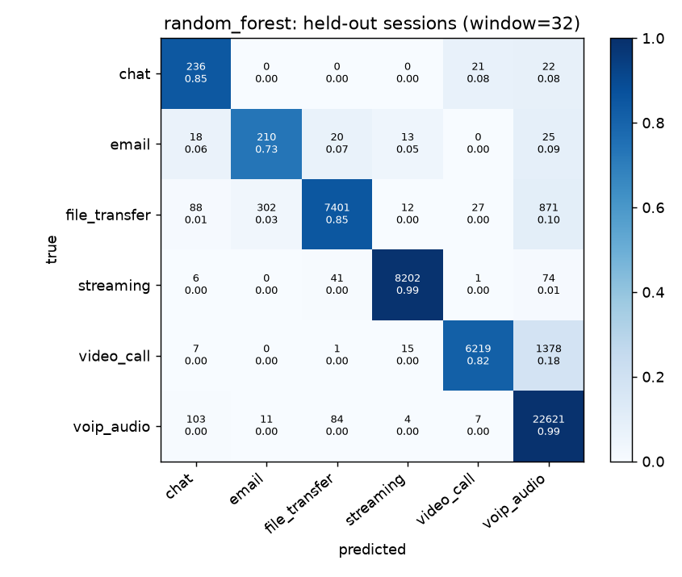
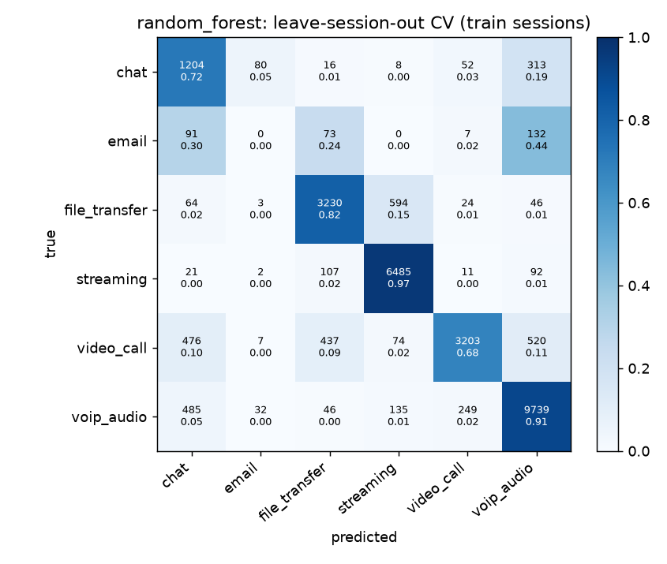
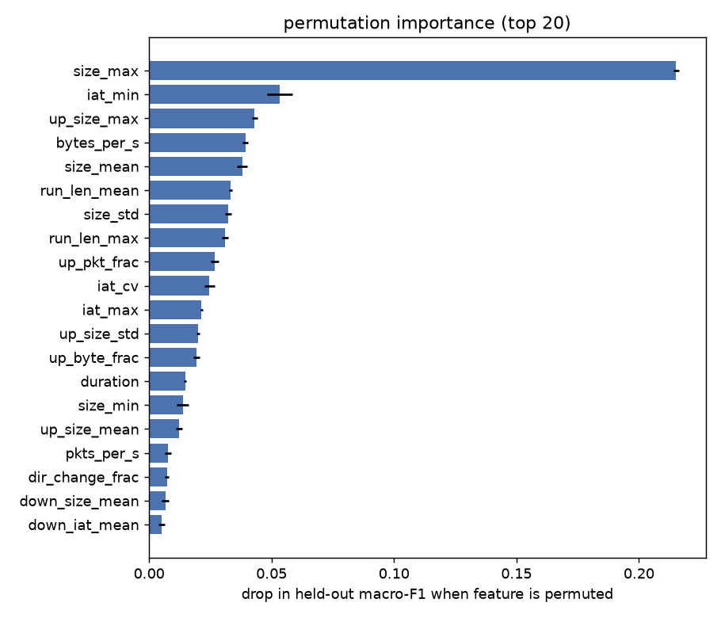
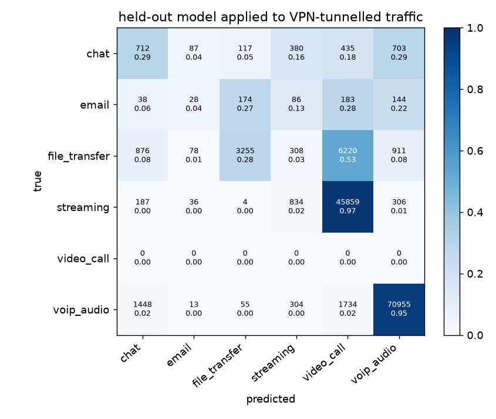

# MetaQoS evaluation report

Generated by `eval/evaluate.py` from `windows_w32.parquet` (window = 32 packets). All numbers below are measured; none are placeholders.

## Data

ISCX VPN-nonVPN 2016, NonVPN captures only (see `data/fetch_iscx.py` for the exact file list). One sample = one window of consecutive packets from one bidirectional flow.

| label | windows | flows | sessions | apps |
|---|---|---|---|---|
| chat | 2341 | 232 | 16 | aim_chat, aimchat, facebook_chat, facebookchat, gmailchat, hangout_chat, hangouts_chat, icq_chat, icqchat, skype_chat |
| email | 589 | 255 | 2 | email |
| file_transfer | 37276 | 100 | 17 | ftps_up, scpdown, sftp_down, sftp_up, sftpdown, sftpup, skype_file |
| streaming | 47100 | 501 | 19 | netflix, spotify, vimeo, youtube, youtubehtml5 |
| video_call | 50301 | 215 | 5 | facebook_video, hangouts_video, skype_video |
| voip_audio | 147579 | 629 | 16 | facebook_audio, hangouts_audio, skype_audio, voipbuster |

* Windows total: 285186. Training windows after capping at 300 per flow: 28058 (from 237146). Held-out windows: 48040.
* Held-out sessions (never used for training or model selection): `facebook_video2`, `hangouts_audio3`, `skype_audio2`, `netflix2`, `youtube4`, `vimeo3`, `sftp_down_3`, `scpDown3`, `skype_file3`, `facebook_chat_4`, `gmailchat2`, `email2`.
* Cross-validation is **leave-sessions-out** (`StratifiedGroupKFold`, 5 folds, grouped by capture session). Splitting by window instead would leak near-duplicate windows of the same flow across folds and report ~99% accuracy that means nothing.

## Model comparison

| model | cv macro-F1 | cv acc | cv fold F1 min/max | held-out macro-F1 | held-out acc | held-out tier acc | single-flow latency (us) | 1-thread latency (us) | batched (us/flow) | size (KB) | fit (s) |
|---|---|---|---|---|---|---|---|---|---|---|---|
| decision_tree | 0.611 | 0.788 | 0.48/0.70 | 0.726 | 0.881 | 0.911 | 58 | 58 | 0.200 | 20 | 0.400 |
| random_forest | 0.671 | 0.850 | 0.52/0.75 | 0.817 | 0.934 | 0.970 | 3473 | 3464 | 10.500 | 3661 | 1.300 |
| hist_gbt | 0.582 | 0.789 | 0.41/0.75 | 0.853 | 0.931 | 0.960 | 2441 | 1596 | 6.800 | 562 | 6.800 |

Latency is per flow decision on this machine (one 32-packet window -> one `predict_proba` call). `1-thread` pins BLAS/OpenMP to one thread, which is what a router CPU would run; sklearn's gradient boosting pays a large fixed per-call cost from its thread pool otherwise.

**Selected model: `random_forest`** (highest leave-session-out macro-F1).

## Held-out sessions: per-class metrics

Accuracy 0.934, macro-F1 0.817, **QoS-tier accuracy 0.970** (tier accuracy counts a prediction as correct when it lands the flow in the right queue, e.g. video_call vs voip_audio are both `realtime`).

| class | precision | recall | f1 | support |
|---|---|---|---|---|
| chat | 0.515 | 0.846 | 0.640 | 279 |
| email | 0.402 | 0.734 | 0.519 | 286 |
| file_transfer | 0.981 | 0.851 | 0.911 | 8701 |
| streaming | 0.995 | 0.985 | 0.990 | 8324 |
| video_call | 0.991 | 0.816 | 0.895 | 7620 |
| voip_audio | 0.905 | 0.991 | 0.946 | 22830 |
| macro avg | 0.798 | 0.871 | 0.817 | 48040 |

### Per held-out capture

| label | app | session | windows | acc |
|---|---|---|---|---|
| chat | facebook_chat | facebook_chat_4 | 196 | 0.816 |
| chat | gmailchat | gmailchat2 | 83 | 0.916 |
| email | email | email2 | 286 | 0.734 |
| file_transfer | scpdown | scpDown3 | 2124 | 0.995 |
| file_transfer | sftp_down | sftp_down_3 | 4539 | 0.731 |
| file_transfer | skype_file | skype_file3 | 2038 | 0.966 |
| streaming | netflix | netflix2 | 3404 | 0.988 |
| streaming | vimeo | vimeo3 | 2860 | 0.999 |
| streaming | youtube | youtube4 | 2060 | 0.963 |
| video_call | facebook_video | facebook_video2 | 7620 | 0.816 |
| voip_audio | hangouts_audio | hangouts_audio3 | 19030 | 0.995 |
| voip_audio | skype_audio | skype_audio2 | 3800 | 0.971 |

### Per held-out flow (>= 100 windows)

Ports shown only to identify the flow; they are not features. This table separates classifier errors from capture-file label noise: a second SSH session inside an SFTP capture is labelled `file_transfer` but carries 57-byte interactive packets (the model calls it voice/chat/email, i.e. small-packet interactive classes), and a video call's separate audio stream is labelled `video_call` but is, in fact, voice.

| session | label | flow | windows | mean pkt B | pkt/s | up byte frac | majority pred | share |
|---|---|---|---|---|---|---|---|---|
| facebook_video2 | video_call | udp :38633<->:51425 | 6175 | 1100 | 487 | 0.500 | video_call | 1.000 |
| facebook_video2 | video_call | udp :35146<->:51424 | 1397 | 118 | 108 | 0.410 | voip_audio | 0.967 |
| hangouts_audio3 | voip_audio | udp :63026<->:19305 | 17532 | 137 | 116 | 0.490 | voip_audio | 0.997 |
| hangouts_audio3 | voip_audio | udp :65191<->:19305 | 503 | 137 | 116 | 0.500 | voip_audio | 1.000 |
| hangouts_audio3 | voip_audio | tcp :49420<->:443 | 485 | 307 | 7 | 0.700 | voip_audio | 0.953 |
| hangouts_audio3 | voip_audio | tcp :49522<->:443 | 308 | 305 | 8 | 0.710 | voip_audio | 0.961 |
| netflix2 | streaming | tcp :80<->:40884 | 3392 | 1079 | 4737 | 0.010 | streaming | 0.988 |
| scpDown3 | file_transfer | tcp :22<->:51957 | 2122 | 1281 | 32000 | 0.010 | file_transfer | 0.995 |
| sftp_down_3 | file_transfer | tcp :22<->:42128 | 2994 | 945 | 32000 | 0.940 | file_transfer | 0.999 |
| sftp_down_3 | file_transfer | tcp :22<->:38033 | 1515 | 57 | 696 | 0.250 | voip_audio | 0.549 |
| skype_audio2 | voip_audio | udp :40273<->:49624 | 3635 | 129 | 105 | 0.500 | voip_audio | 0.999 |
| skype_file3 | file_transfer | udp :40273<->:49624 | 2015 | 703 | 610 | 0.930 | file_transfer | 0.967 |
| vimeo3 | streaming | tcp :54394<->:443 | 2812 | 1234 | 391 | 0.000 | streaming | 1.000 |
| youtube4 | streaming | tcp :54334<->:443 | 1030 | 1058 | 31221 | 0.010 | streaming | 1.000 |
| youtube4 | streaming | tcp :44157<->:443 | 574 | 951 | 26436 | 0.020 | streaming | 0.998 |
| youtube4 | streaming | tcp :58936<->:443 | 302 | 1041 | 10966 | 0.010 | streaming | 1.000 |

## Leave-session-out CV: per-class metrics (training sessions, out-of-fold)

Accuracy 0.850, macro-F1 0.671; per-fold macro-F1: 0.523, 0.746, 0.629, 0.633, 0.692.

| class | precision | recall | f1 | support |
|---|---|---|---|---|
| chat | 0.514 | 0.720 | 0.600 | 1673 |
| email | 0 | 0 | 0.000 | 303 |
| file_transfer | 0.826 | 0.815 | 0.821 | 3961 |
| streaming | 0.889 | 0.965 | 0.926 | 6718 |
| video_call | 0.903 | 0.679 | 0.775 | 4717 |
| voip_audio | 0.898 | 0.911 | 0.905 | 10686 |
| macro avg | 0.672 | 0.682 | 0.671 | 28058 |

## Early classification (held-out)

How accurate is the decision after the first window vs later, for raw per-window predictions and for the EMA-smoothed decision the re-classification loop uses (alpha = 0.4)?

| windows seen | n | raw acc | smoothed acc |
|---|---|---|---|
| 1st window | 439 | 0.624 | 0.624 |
| 2nd | 111 | 0.613 | 0.730 |
| 3rd-5th | 176 | 0.739 | 0.750 |
| 6th-20th | 526 | 0.781 | 0.789 |
| 21st+ | 46788 | 0.941 | 0.905 |

## Feature importance (permutation, held-out macro-F1)

| feature | importance | std |
|---|---|---|
| size_max | 0.215 | 0.001 |
| iat_min | 0.053 | 0.005 |
| up_size_max | 0.043 | 0.001 |
| bytes_per_s | 0.039 | 0.001 |
| size_mean | 0.038 | 0.002 |
| run_len_mean | 0.033 | 0.001 |
| size_std | 0.032 | 0.001 |
| run_len_max | 0.031 | 0.001 |
| up_pkt_frac | 0.027 | 0.002 |
| iat_cv | 0.025 | 0.002 |
| iat_max | 0.021 | 0.001 |
| up_size_std | 0.020 | 0.001 |
| up_byte_frac | 0.019 | 0.001 |
| duration | 0.015 | 0.000 |
| size_min | 0.014 | 0.002 |

## Ablation: without the transport-protocol flag

`proto_udp` is the only header field used. Removing it: CV macro-F1 0.667, held-out macro-F1 0.789, held-out accuracy 0.934 (vs 0.671 / 0.817 / 0.934 with it).

## Inference cost

* Model file: 3662 KB (joblib, compressed).
* Single-flow latency: median 3722 us (p95 4162 us); pinned to one thread: 3520 us. Batched: 11.2 us/flow.
* Feature extraction for one window is a few NumPy reductions over 32 values (~50 us in Python).

## Window size sweep

Same model type (`random_forest`), same session split, different observation window. A smaller window decides sooner (8 packets is ~80 ms of a VoIP call) but sees less.

| window (pkts) | train windows | cv macro-F1 | cv acc | held-out macro-F1 | held-out acc |
|---|---|---|---|---|---|
| 8 | 53669 | 0.547 | 0.688 | 0.755 | 0.909 |
| 16 | 38337 | 0.575 | 0.756 | 0.774 | 0.912 |
| 32 | 28058 | 0.671 | 0.850 | 0.817 | 0.934 |
| 64 | 20683 | 0.644 | 0.838 | 0.903 | 0.960 |

## DPI baseline: nDPI vs MetaQoS on the same flows

nDPI 4.x via nfstream, run over the same held-out captures, on the 298 flows (>= 32 packets) that both systems see, carrying 1,329,698 packets.

nDPI is scored generously: only labels whose protocol *determines* an activity are mapped (`SSH`->file transfer, `IMAPS`/`POPS`/`SMTPS`->email, `RTP`/`DTLS.SRTP`->real-time, `TLS.YouTube`/`TLS.NetFlix`->streaming). Generic labels (`TLS`, `HTTP`, `QUIC.Google`, `Unknown`) count as **abstentions, never as errors**. The tier row additionally gives nDPI full credit for `STUN`/`DTLS`->realtime without distinguishing a video call from a voice call.

| system | flows decided | packets covered | acc when decided | packet-weighted acc, all flows |
|---|---|---|---|---|
| nDPI (class) | 0.487 | 0.464 | 0.993 | 0.430 |
| nDPI (QoS tier) | 0.493 | 0.765 | 1.000 | 0.765 |
| MetaQoS (class) | 1.000 | 1.000 | 0.752 | 0.879 |
| MetaQoS (QoS tier) | 1.000 | 1.000 | 0.819 | 0.914 |

**The gap is coverage, not correctness.** When nDPI commits to a class it is right 99.3% of the time - but it commits on only 48.7% of flows, carrying 46.4% of the packets. Even at tier level, where it is scored most favourably, it covers 76.5% of packets. MetaQoS decides on every flow and gets 91.4% of packets into the right queue.

The reason is visible in what nDPI actually returns on this traffic:

| ndpi_app | flows | packets | mapped | % of packets |
|---|---|---|---|---|
| STUN | 2 | 400354 | 0 | 30.100 |
| RTP | 2 | 358278 | 2 | 26.900 |
| Unknown | 42 | 186605 | 0 | 14.000 |
| SSH | 4 | 154181 | 4 | 11.600 |
| TLS | 36 | 57336 | 0 | 4.300 |
| HTTP | 3 | 51149 | 0 | 3.800 |
| DTLS.SRTP | 1 | 44706 | 1 | 3.400 |
| TLS.YouTube | 5 | 35282 | 5 | 2.700 |
| STUN.RTP | 1 | 16086 | 1 | 1.200 |
| TLS.Google | 32 | 11518 | 0 | 0.900 |
| SMTPS | 100 | 3980 | 100 | 0.300 |
| IMAPS | 21 | 3771 | 21 | 0.300 |

`TLS`, `TLS.Google` and `TLS.Facebook` identify the vendor, not the activity: the same label covers a Hangouts video call, a YouTube stream and a Gmail chat, which belong in three different queues. That is the structural limit metadata classification is designed around - and on 2016 traffic nDPI still has cleartext SNI and certificates to work with. On modern traffic with encrypted ClientHello its coverage would be lower, not higher.

Caveats: nDPI is doing a harder and more general job than MetaQoS (it identifies hundreds of protocols with no training data, and it is right about the protocol far more often than this table's class mapping credits it for). This compares the two only as sources of a QoS queueing decision.

## Robustness: VPN-tunnelled traffic (measured, not simulated)

The model trained only on non-VPN traffic, applied unchanged to the ISCX OpenVPN captures of the same activities. `video_call` has no VPN capture in the release, so this covers 5 classes: `chat`, `email`, `file_transfer`, `streaming`, `voip_audio`. The non-VPN baseline below is the held-out set restricted to those same classes, so the comparison is like-for-like.

| set | windows | accuracy | macro-F1 | QoS-tier accuracy |
|---|---|---|---|---|
| non-VPN held-out | 40420 | 0.957 | 0.674 | 0.965 |
| VPN-tunnelled | 136470 | 0.555 | 0.289 | 0.570 |
| **change** | | **-0.401** | **-0.384** | **-0.395** |

**This number must not be read as 'MetaQoS works through a VPN.'** Inside a tunnel every application shares one 5-tuple, so per-flow classification cannot separate concurrent applications at all. Each ISCX VPN capture contains a single activity, so the tunnel flow still carries that activity's timing and size signature; the measurement answers only the narrower question of whether tunnelling destroys that signature.

| class | precision | recall | f1 | support |
|---|---|---|---|---|
| chat | 0.218 | 0.293 | 0.250 | 2434 |
| email | 0.116 | 0.043 | 0.063 | 653 |
| file_transfer | 0.903 | 0.279 | 0.427 | 11648 |
| streaming | 0.436 | 0.018 | 0.034 | 47226 |
| voip_audio | 0.972 | 0.952 | 0.962 | 74509 |
| macro avg | 0.529 | 0.317 | 0.347 | 136470 |

### Per VPN capture

| label | file | windows | acc | majority |
|---|---|---|---|---|
| chat | vpn_aim_chat1a | 32 | 0.969 | chat |
| chat | vpn_aim_chat1b | 40 | 0.950 | chat |
| chat | vpn_facebook_chat1a | 241 | 0.378 | chat |
| chat | vpn_facebook_chat1b | 201 | 0.363 | streaming |
| chat | vpn_hangouts_chat1a | 773 | 0.060 | video_call |
| chat | vpn_hangouts_chat1b | 454 | 0.161 | voip_audio |
| chat | vpn_icq_chat1a | 126 | 0.984 | chat |
| chat | vpn_icq_chat1b | 115 | 0.983 | chat |
| chat | vpn_skype_chat1a | 217 | 0.313 | email |
| chat | vpn_skype_chat1b | 235 | 0.234 | file_transfer |
| email | vpn_email2a | 75 | 0.120 | voip_audio |
| email | vpn_email2b | 578 | 0.033 | video_call |
| file_transfer | vpn_ftps_A | 3206 | 0.519 | file_transfer |
| file_transfer | vpn_ftps_B | 2758 | 0.000 | video_call |
| file_transfer | vpn_sftp_A | 2840 | 0.345 | video_call |
| file_transfer | vpn_sftp_B | 630 | 0.000 | video_call |
| file_transfer | vpn_skype_files1a | 1267 | 0.237 | voip_audio |
| file_transfer | vpn_skype_files1b | 947 | 0.328 | file_transfer |
| streaming | vpn_netflix_A | 27163 | 0.011 | video_call |
| streaming | vpn_spotify_A | 3595 | 0.036 | video_call |
| streaming | vpn_vimeo_A | 3267 | 0.009 | video_call |
| streaming | vpn_vimeo_B | 6708 | 0.008 | video_call |
| streaming | vpn_youtube_A | 6493 | 0.048 | video_call |
| voip_audio | vpn_facebook_audio2 | 364 | 0.245 | chat |
| voip_audio | vpn_hangouts_audio1 | 13752 | 0.965 | voip_audio |
| voip_audio | vpn_hangouts_audio2 | 14663 | 0.905 | voip_audio |
| voip_audio | vpn_skype_audio1 | 11674 | 0.945 | voip_audio |
| voip_audio | vpn_skype_audio2 | 11590 | 0.941 | voip_audio |
| voip_audio | vpn_voipbuster1a | 11219 | 0.996 | voip_audio |
| voip_audio | vpn_voipbuster1b | 11247 | 0.997 | voip_audio |

## Transport-property ablation (which property breaks the model)

ISCX predates QUIC, so QUIC robustness cannot be measured directly. Instead each transport property that QUIC changes is removed from the **real** held-out captures one at a time, at the packet level, and the unchanged model is re-run. That attributes the damage to a specific property.

| transform | what it does |
|---|---|
| `mtu1360` | cap packets at 1360 B (the ISCX VPN captures' tun MTU) |
| `mtu1200` | cap at 1200 B, QUIC's mandatory minimum datagram |
| `noacks` | drop pure-ACK packets (TCP, <= 66 B); QUIC hides ACK frames inside encrypted packets |
| `asudp` | relabel the transport as UDP, as QUIC appears |
| `quiclike` | all three together (1350 B + no visible ACKs + UDP) |

| transform | windows | accuracy | macro_f1 | tier_accuracy | delta_acc |
|---|---|---|---|---|---|
| baseline | 48040 | 0.934 | 0.817 | 0.970 | 0.000 |
| mtu1360 | 57675 | 0.520 | 0.333 | 0.553 | -0.414 |
| mtu1200 | 58565 | 0.518 | 0.366 | 0.547 | -0.416 |
| noacks | 43273 | 0.906 | 0.670 | 0.938 | -0.029 |
| asudp | 48040 | 0.933 | 0.815 | 0.969 | -0.001 |
| quiclike | 52914 | 0.541 | 0.278 | 0.567 | -0.393 |

Per-class F1 under each transform:

| class | baseline | mtu1360 | mtu1200 | noacks | asudp | quiclike |
|---|---|---|---|---|---|---|
| chat | 0.640 | 0.158 | 0.250 | 0.517 | 0.635 | 0.259 |
| email | 0.519 | 0.401 | 0.527 | 0.010 | 0.519 | 0.010 |
| file_transfer | 0.911 | 0.170 | 0.164 | 0.771 | 0.907 | 0.095 |
| streaming | 0.990 | 0.010 | 0.018 | 0.868 | 0.990 | 0.000 |
| video_call | 0.895 | 0.375 | 0.388 | 0.896 | 0.895 | 0.352 |
| voip_audio | 0.946 | 0.882 | 0.848 | 0.961 | 0.945 | 0.949 |
| macro avg | 0.817 | 0.333 | 0.366 | 0.670 | 0.815 | 0.278 |

**`quiclike` is not a QUIC measurement.** It is real traffic carrying QUIC's packet-level consequences; it does not reproduce QUIC pacing, congestion control, stream multiplexing or 0-RTT. Quote it as a sensitivity ablation. The only way to fill the QUIC row properly is to capture real HTTP-3 traffic and re-run `eval/evaluate.py` against it.
